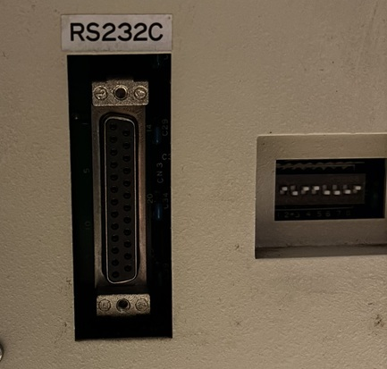
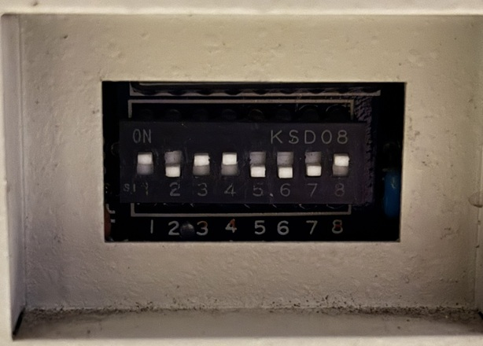
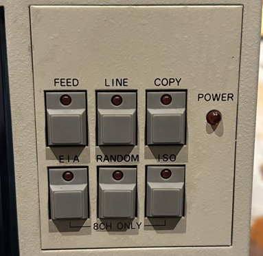

# 調査結果

NPR-5200 の資料が手元になかったため、実機で試して分かったことをまとめます。「確定」は実機で再現を確認したもの、「未確定」は確認できていないものです。

## 1. シリアルの結線

### 接続構成

PC の USB シリアルアダプタ(FT232R)の出力を、レベル変換器で RS-232C レベルにして、機器の DB25 コネクタに接続しています。

背面の RS232C コネクタ(DB25)と、その右隣の DIP スイッチ窓です。

### ピン接続

| DB25 ピン | 信号 | 接続 |
|---|---|---|
| 2 | 機器の TXD(送信) | **PC の RXD** |
| 3 | 機器の RXD(受信) | **PC の TXD** |
| 7 | GND | PC の GND |
| 20 | 機器の DTR | 機器側のコネクタで折り返す場合は、 CTS(5 番)、DSR(6 番)、DCD(8 番)に接続 |
| 5 | CTS | 20 番(DTR)に接続 |
| 8 | DCD | 20 番(DTR)に接続 |
| 6 | DSR | 20 番(DTR)に接続 |

### 使えたケーブル

D-sub 9 ピンから 25 ピンへの変換には、次のケーブルが使えました。

- <https://www.amazon.co.jp/dp/B00066HL50>

製品は StarTech.com の 3 m クロスケーブル(ヌルモデムケーブル、D-Sub 9 ピン メス - D-Sub 25 ピン オス)です。実際に接続して、動作することを確認しました。

### 注意点

1. **機器は DTE 型です。** 機器の送信が 2 番、受信が 3 番です。モデムとつなぐ向きとは逆で、PC の TXD は 3 番につなぎます。確認のために、何も接続しない状態で 2 番ピンの電圧を測ると約 -10 V で、機器が送信側であることが分かりました。連続送信中は約 +7 V でした。
2. **GND(7 番)を必ず接続してください。**
3. **DTR(20 番)は、前面の LINE ボタンで極性が反転します。** この信号を機器自身の CTS(5 番)、DSR(6 番)、DCD(8 番)に戻して、機器がオンラインのときだけ動くようにしています。
4. **ハードウェアフロー制御は使えません。** 機器は XON/XOFF(XOFF)も送ってきません。大きなデータは、PC 側で送信速度を落としてください(`punch.py --cps 30`)。全速で送ると、機器のバッファがあふれます。
5. **エラー LED は、COPY ボタンで解除できます。** ボーレートや書式の不一致、バッファあふれがあると、前面パネルの LINE ランプと、モードのランプ(RANDOM など)が点滅します。この状態では、何を送っても反応しません。前面パネルの COPY ボタンを押すと解除されます。電源を入れ直す必要はありません。
6. **シリアルの書式は 8N1 です。** 8N2 でも動きます。7E1 や 7O1 では文字化けし、8E1 や 8O1 ではエラー LED が点灯します。Linux の termios は 1.5 ストップビットを扱えないため、1.5 は試せていません。

## 2. DIP スイッチ

### 現在の設定

`SW1〜SW8 = ON,OFF,ON,ON,OFF,OFF,OFF,ON` → 9600 baud、8N1、制御コード素通し、モーターは入力があると回転。

DIP スイッチの拡大写真です(KSD08、1〜8 番)。

### 各スイッチの働き

| SW | 働き | 状況 |
|---|---|---|
| 1 | ON: DC1〜DC4 を制御コードにせず素通し。全 256 コードをパンチでき、パンチは常時 ON。OFF: DC2(0x12)でパンチ ON、DC4(0x14)でパンチ OFF | 確定 |
| 2 | ON: モーター常時回転。OFF: シリアル入力があると回転し、しばらくして停止 | 確定 |
| 3、4 | 不明 | 未確定 |
| 5、6、7、8 | ボーレート | 一部確定(下記参照) |

### SW1 OFF のときの制限

DC1〜DC4 が制御コードになるため、次のコードはパンチできません。

- 0x11、0x12、0x14(ISO モードでの 0x93 も)

0x13 はパンチされます。任意のコードをパンチしたいときは、SW1 を ON にしてください。

### モードの違い(前面パネルのスイッチ)

- **RANDOM**: 受け取ったバイトをそのままパンチします。
- **ISO**: 8 ビット目に偶数パリティを付けます。0x13 を送ると 0x93 がパンチされます。
- **EIA**: ASCII を EIA コードに変換します。例えば `A` は 0x61 になります。表にないコードは捨てられるので、任意のパターンを打つ用途には向きません。

### ボーレート

SW1 ON、SW2 OFF、SW3 ON、SW4 ON の状態で調べました。SW3 と SW4 はボーレートに影響しませんでした。

| SW5 | SW6 | SW7 | SW8 | ボーレート | 状況 |
|---|---|---|---|---|---|
| ON | ON | ON | OFF | 4800 | 確定 |
| OFF | ON | ON | OFF | 2400 | 確定 |
| ON | OFF | ON | OFF | 1200 | 確定 |
| OFF | OFF | ON | OFF | 600 | 確定 |
| ON | ON | OFF | OFF | 300 | 確定 |
| OFF | OFF | OFF | OFF | 9600 | 確定 |
| OFF | ON | OFF | OFF | 不明 | 未確定 |
| ON | OFF | OFF | OFF | 不明 | 未確定 |
| ON | ON | ON | ON | 9600 | 確定 |
| OFF | ON | ON | ON | 9600 | 確定 |
| OFF | OFF | OFF | ON | 9600 | 確定 |
| ON | OFF | ON | ON | 不明 | 未確定 |
| OFF | OFF | ON | ON | 不明 | 未確定 |
| ON | ON | OFF | ON | 不明 | 未確定 |

不明の組み合わせの調査範囲は次のとおりです。

- SW8 = OFF で不明の 2 通り: 4800、9600、2400、1200、19200、600、300、38400、110、150、134、75 の 8N1 では、どれも合いませんでした。
- SW8 = ON で不明の 3 通り: 低い速度(300〜4800 付近)しか試していません。

単純な分周ではなさそうです。

### ボーレートが合っていないか調べる方法

`0x00` を送ると分かります。9600 で送った `0x00` を、4800 で待つ機器が受けると、`0xF8` や `0xF0` としてパンチされます。パンチされた文字が文字化けしていたら、DIP の設定と `--baud` が合っているかを確認してください。

### SW3、SW4 について

4 通りの組み合わせをすべて試しましたが、ボーレート、書式(パリティ)、DC コードの扱い、特殊コード(NUL、BEL、BS、HT、LF、VT、FF、CR、SUB、ESC、SP、DEL、0x80、0xFF)のパンチに、変化はありませんでした。リーダ側の機能かもしれませんが、リーダは試していません。

## 3. 前面パネル

前面パネルには、FEED、LINE、COPY、EIA、RANDOM、ISO のボタン(それぞれにランプ付き)と POWER ランプがあります。モードの選択(EIA/RANDOM/ISO)は 8 チャンネルのときだけ有効と、パネルに印刷されています。

## 4. 背面の「TNE ON/OFF」スイッチ

背面に「TNE ON/OFF」と書かれたスイッチがありますが、意味は確認していません。

## 5. 未確認のこと

- SW3、SW4 の機能
- ボーレートの未確定の組み合わせ
- テープリーダの動作(読み取りには、機器の 2 番ピンを PC の RXD につなぐ必要があります)
- バッファがあふれる正確なデータ量(200 バイトは全速で問題ありませんでしたが、KB 単位ではあふれました)
- ESC(0x1B)が一度だけ欠落したこと(再現しませんでした)
