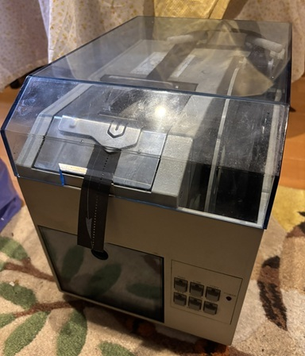
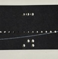
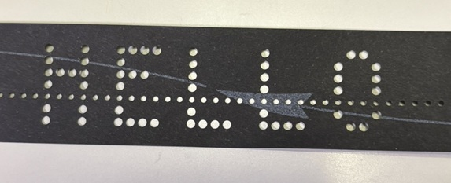
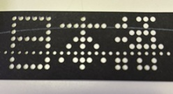

# Ricom NPR-5200 紙テープパンチ制御ツール

Ricom NPR-5200 紙テープパンチャ/リーダを、FT232R などの USB シリアルアダプタ経由で PC から制御する Python スクリプト集です。



銘板: RICOM NPR-5200(TYPE 600337、1987 年 5 月製、RICOH DENSHI)


## クイックスタート

1. **配線する。** PC の TXD をレベル変換器を通して、機器の DB25 の 3 番に接続します。GND は 7 番です。機器の DTR(20 番)は、CTS(5 番)、DSR(6 番)、DCD(8 番)に接続します。詳しくは [INVESTIGATION.md](INVESTIGATION.md) を見てください。
2. **DIP スイッチを設定する。** 背面の DIP スイッチを、1〜8 番の順に `ON,OFF,ON,ON,OFF,OFF,OFF,ON` にします(9600 baud、制御コード素通し)。
3. **機器を準備する。** 電源を入れて、前面パネルの RANDOM を選び、紙テープをセットします。LINE ランプが点灯していることを確認します。
4. **ライブラリを入れる。** `pip install pyserial pillow`
5. **ポートの権限を確認する。** `/dev/ttyUSB0` を使えるように、ユーザーを `dialout` グループに入れます(`sudo usermod -aG dialout $USER`。再ログインが必要です)。
6. **パンチする。**

```
python3 punch.py -t "ABC"
```

テープに `A`、`B`、`C` の穴が開けば成功です。パンチ結果の例です。



文字をドット絵にするときは、次のようにします。

```
python3 dotpunch.py "HELLO" --dry-run   # プレビューだけ
python3 dotpunch.py "HELLO"             # パンチ
```

「HELLO」のパンチ結果です。



**うまくいかないとき**
- LINE ランプとモードのランプが点滅したら、COPY ボタンを押して解除します。そのあと、ボーレート(DIP の 5〜8 番と `--baud`)と配線を確認してください。
- 変な文字(`0xF0` や `0xF8` など)がパンチされたら、ボーレートが合っていません。
- 何もパンチされないときは、DSR の接続と、LINE ランプの状態を確認します。

## 必要なもの

- Python 3
- pyserial(`pip install pyserial`)
- Pillow(`pip install pillow`。`dotpunch.py` で日本語を打つときに必要)
- 美咲ゴシックのフォントファイル(`misaki_gothic.ttf`。日本語を打つときに必要。下記参照)

シリアルポートを使うには、ユーザーが `dialout` グループに入っている必要があります。

## 動作確認済みの環境

- OS: Linux 7.0(Ubuntu 系)
- Python 3.14.4
- pyserial 3.5
- Pillow 12.1.1
- USB シリアルアダプタ: FT232R(レベル変換器を経由して DB25 に接続)

他の環境では確認していません。

## 機器側の設定

既定値は次のとおりです。

- 9600 baud、8N1
- DIP スイッチ(1〜8 番): `ON,OFF,ON,ON,OFF,OFF,OFF,ON`
- モードは RANDOM(前面パネルの EIA/RANDOM/ISO で選択)

1 番が ON のときは、DC1〜DC4 が制御コードにならず、全 256 コードをそのままパンチできます。1 番が OFF のときは、`--dc` を付けてください。

ボーレートや書式が合っていないと、LINE とモードの LED が点滅します。前面パネルの COPY ボタンを押すと解除されます。

配線や DIP スイッチの詳しい調査結果は、[INVESTIGATION.md](INVESTIGATION.md) にあります。

## 使い方

### punch.py: 任意のデータをパンチ

```
python3 punch.py -t "HELLO"             # 文字列
python3 punch.py -t "HELLO" --crlf      # 末尾に CRLF を付ける
python3 punch.py -x "41 42 43 00 FF"    # 16進
python3 punch.py -f data.bin            # ファイル
```

主なオプション:

| オプション | 既定値 | 説明 |
|---|---|---|
| `--dev` | `/dev/ttyUSB0` | シリアルデバイス |
| `--baud` | 9600 | ボーレート |
| `--cps` | 30 | 送信速度の上限(文字/秒)。0 で制限なし |
| `--leader` | 0 | 先頭に付ける 0x00 の数 |
| `--trailer` | 35 | 末尾に付ける 0x00 の数 |
| `--dc` | なし | DC2/DC4 の枠を付ける(DIP 1 番が OFF のとき) |
| `--iso` | なし | ISO モード用。0x93 を 0x13 に変換する |
| `--force` | なし | パンチできないコードを含んでいても送る |

`--cps` を指定せずに大きなデータを全速で送ると、機器のバッファがあふれてエラー LED が点灯します。既定の 30 文字/秒のまま使ってください。

### dotpunch.py: 文字をドット絵にしてパンチ

テープの 8 トラックを縦 8 ドットとみなして、文字をテープの長さ方向に並べて打ちます。1 バイトが 1 列です。

```
python3 dotpunch.py "HELLO" --dry-run   # パンチせずにプレビューだけ表示
python3 dotpunch.py "HELLO" --yes       # 確認なしでパンチ
python3 dotpunch.py "ﾆﾎﾝｺﾞ"             # 半角カナ(全角字形で打つ)
python3 dotpunch.py "日本語"            # 漢字
```

「HELLO」のパンチ結果です。


- ASCII は内蔵の 5x8 フォントで打ちます。
- 日本語は美咲ゴシック(8x8)で打ちます。画数の多い漢字は、8 ドットでは読みにくくなります。「日本語」のパンチ結果です。

  

- 既定では上下を反転して出力します。実機で上下が逆に出たためです。逆にしたいときは `--no-flip` を付けます。
- その他のオプション: `--scale`(拡大)、`--gap`(文字間隔)、`--reverse`、`--half-kana`(半角カナを全角にしない)、`--font`(フォントの指定)。

### probe.py: 調査用

DIP スイッチやボーレートの調査用です。サブコマンドは `status`、`sweep`、`guided`、`dipbaud`、`dipprobe`、`dipcodes`、`send` です。`dipbaud`、`dipprobe`、`dipcodes` は、結果をログファイルに書き出します。

## フォントの入手方法

日本語のドット絵には、美咲フォント(美咲ゴシック)を使います。フォント本体は、このリポジトリには含めていません(`.gitignore` で除外しています)。ライセンスは `MISAKI_COPYRIGHT.txt` を見てください。

1. 配布元 <https://littlelimit.net/misaki.htm> から、TTF 版の zip をダウンロードします。
2. zip を展開して、`misaki_gothic.ttf` を `dotpunch.py` と同じディレクトリに置きます。

Debian や Ubuntu では、パッケージからも入手できます。

```
sudo apt install fonts-misaki
# 入ったファイルを探して、このディレクトリにコピーする
find /usr/share/fonts -iname 'misaki_gothic*.ttf'
```

別の場所に置いたときは、`--font /path/to/misaki_gothic.ttf` で指定します。ASCII だけを打つなら、フォントは不要です。

## ライセンス

このリポジトリのコード(`punch.py`、`dotpunch.py`、`probe.py`)は、MIT ライセンスです。詳しくは [LICENSE](LICENSE) を見てください。

美咲フォントは、このコードとは別のライセンスです。詳しくは `MISAKI_COPYRIGHT.txt` を見てください。
